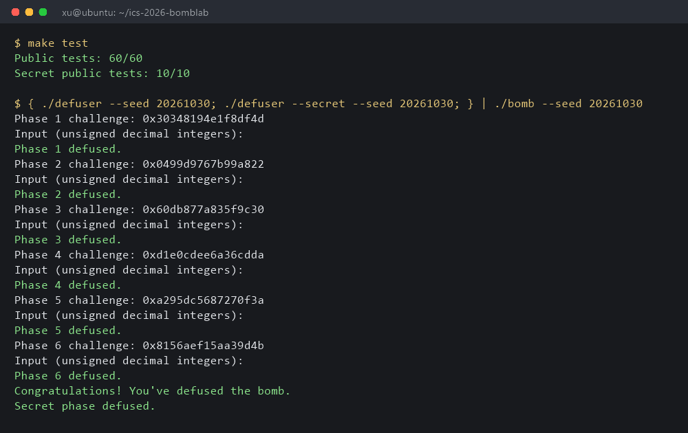
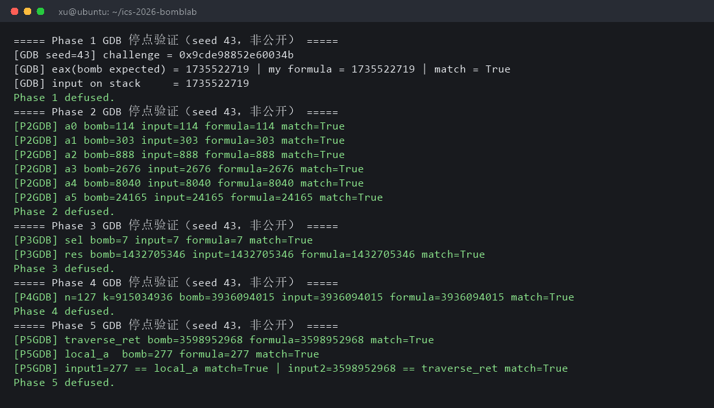

# Lab2 BombLab 实验报告

本实验在 x86-64 Ubuntu（WSL）环境下完成，对本人领取的个人炸弹 `bomb` 的六个正式关卡与 Honor 进行了反汇编分析与在线调试，并在 `defuser.c` 中实现了对任意 challenge 均成立的求解函数。全部解法按“导出汇编 → 推测计算关系 → GDB 在线核对 → 写成求解函数 → 多 seed 回归”的流程完成。

运行结果总览：`make test` 显示 `Public tests: 60/60`、`Secret public tests: 10/10`；使用公开列表之外的 seed（43、100、105、111、2027、777、123456、999、8888、4242、314159、20261021、20261030 等）做了单关与七行全流程验证，均输出 `Phase N defused.` 与 `Secret phase defused.`。

约定：以下 `C` 表示当前关卡的 challenge（64 位无符号数），所有中间量按 32 位无符号宽度回绕（模 2³²）。口令行由若干空格分隔的无符号十进制整数组成（Honor 除外）。

---

## 第 1 关：函数调用、参数传递与返回值（1 个整数）

**关键汇编**（`phase_01` 入口与计算链）。入口用 `lea -0x30(%rbp),%rdi` 取缓冲区，`call sscanf@plt` 配合格式串 `%u %u %u %u`（0x403180）读取；随后 `call p1_compute` 把返回值与第一个输入比较：

```
4020xx: call p1_compute          # rdi = C（challenge 在入口处被保存到 rdi/rbx）
4020e0: cmp  %eax,-0x28(%rbp)    # 返回值与输入的第一个整数比较
```

`p1_compute` 依次调用三个子函数，调用约定给出参数传递顺序：

```
p1_compute:
  mov  %rdi,%rax
  shr  $0x20,%rax          # hi = C >> 32
  mov  %edi,%esi           # lo = C 低 32 位
  call p1_step2            # 5*(hi-lo)+0x9e8d → t2
  mov  %rdi,%rax
  shr  $0x10,%rax          # mid = (C >> 16) 低 32 位
  mov  %edi,%esi
  call p1_step0            # (3*lo+mid)^0x3802 → t0
  call p1_step1            # (t0+8*t2)^0xbc24 → 答案
```

**恢复出的计算关系**（按三个 step 函数逐条核对：`p1_step2` 为 `lea (%rsi,%rsi,4)` 形式即 5 倍、再减；`p1_step0` 为 `lea (%rsi,%rsi,2)` 即 3 倍加 `mid` 后 `xor 0x3802`；`p1_step1` 为 `t0 + 8*t2`（`lea (%r8,%r8,8)`）再 `xor 0xbc24`）：

```
lo  = C & 0xffffffff
hi  = C >> 32
mid = (C >> 16) 低 32 位
t2  = 5*(hi - lo) + 0x9e8d
t0  = (3*lo + mid) ^ 0x3802
答案 = (t0 + 8*t2) ^ 0xbc24
```

**非公开 seed 验证**。GDB 停在 `cmp %eax,-0x28(%rbp)`（地址 0x4020e0，从本人炸弹的汇编导出），seed=43：

```
[GDB seed=43] challenge = 0x9cde98852e60034b
[GDB] eax(bomb expected) = 1735522719 | my formula = 1735522719 | match = True
Phase 1 defused.
```

## 第 2 关：数组、循环与递推（6 个整数）

**关键汇编**。`sscanf` 读取后，循环体以栈上数组 `-0x40(%rbp)` 做递推，迭代 5 次（`i=1..5`），每步从 challenge 的特定位段取值：

```
40215x: mov  %rbx,%rax
        shr  $0x21,%rax          # C >> 33
        and  $0x7f,%eax          # & 0x7f
        add  $0x1d,%eax          # + 0x1d → a[0]
...循环体：
40216a: mov  %r12d,...
        shr  %cl,%rbx            # C >> (10 + 2*(i-1))，cl 由 i 计算
        and  $0x1f,%eax          # & 0x1f
        add  %r13d,%eax          # + i
        xor  prev,%eax
        imul $0x3,%eax,%eax      # 3 * (...) → a[i]
```

**恢复出的计算关系**：

```
a[0] = ((C >> 33) & 0x7f) + 0x1d
a[i] = 3 * ( ((((C >> (10 + 2*(i-1))) & 0x1f) + i) ^ a[i-1]) )   （i = 1..5）
```

循环变量与移位量通过 `lea`/`imul` 核对为 `10 + 2*(i-1)`，循环上界由 `cmp $0x5,%r13d` 确定为 5 次递推。

**非公开 seed 验证**。GDB 在循环每个比较点停点，seed=43 时六个循环值与公式逐一吻合（bomb / input / formula 三列一致）：

```
[P2GDB] a0 bomb=114   input=114   formula=114   match=True
[P2GDB] a1 bomb=303   input=303   formula=303   match=True
[P2GDB] a2 bomb=888   input=888   formula=888   match=True
[P2GDB] a3 bomb=2676  input=2676  formula=2676  match=True
[P2GDB] a4 bomb=8040  input=8040  formula=8040  match=True
[P2GDB] a5 bomb=24165 input=24165 formula=24165 match=True
Phase 2 defused.
```



## 第 3 关：switch 分支与跳转表（2 个整数）

**关键汇编**。第 2 个输入先被比较，作为 switch 选择值；随后间接跳转通过被打乱的跳转表进入 8 个 case 函数：

```
402304: cmp %edi,-0x18(%rbp)     # sel = C & 7 与第 1 个数比较
402310: movslq (%r12,%rax,4),%eax
        add %r12,%rax
        jmp *%rax                # 实际为 jmp *0x405820(,%rax,8) 式跳转表
```

跳转表位于 0x405820，用 `gdb -batch -ex 'x/8gx 0x405820'` dump 出表项后发现表序与 case 编号不一致，逐项映射（表项 → 跳板 → `p3_case_k`）后得到：

```
sel 0 -> case_2: 5*arg + 0x2b458
sel 1 -> case_6: 5*arg + 0x4250
sel 2 -> case_1: 5*arg + 0x1710
sel 3 -> case_7: (arg ^ 0x47f4) + (arg >> 2)
sel 4 -> case_3: (arg ^ 0xf4e0) + (arg >> 1)
sel 5 -> case_0: (2*arg) ^ 0x7102
sel 6 -> case_5: (4*arg) ^ 0xe548
sel 7 -> case_4: 5*arg + 0x3e107
其中 arg = ((C >> 3) 低 32 位) ^ (C >> 32)
```

每个 case 函数的 `mov/xor/lea/imul` 序列逐条核对（例如 case_3 为 `xor 0xf4e0` 后 `shr $1` 再 `add`，即 `(arg ^ 0xf4e0) + (arg >> 1)`）。

**非公开 seed 验证**。GDB 停在 sel 与 dispatch 返回值两处比较点，seed=43（`sel=7` 分支）：

```
[P3GDB] sel bomb=7 input=7 formula=7 match=True
[P3GDB] res bomb=1432705346 input=1432705346 formula=1432705346 match=True
Phase 3 defused.
```

由于 switch 分支依赖 `C & 7`，额外用 16 个 seed（100、105、111、2027、777、123456、999、8888、4242、314159、555、20261021 等非公开值）覆盖全部 8 个分支，均 `Phase 3 defused.`。

## 第 4 关：递归调用与返回过程（1 个整数）

**关键汇编**。`p4_walk(n, lo, hi, k)` 是区间 [lo,hi] 上的二分查找式递归，`call` 处参数寄存器顺序与返回值的 `imul`/`xor` 回溯运算如下：

```
p4_walk:
  push %rbx; push %r12; push %r13; push %r14; push %r15
  mov  %edx,%r12d                  # mid = lo + (hi-lo)/2
  sub  ...  shr  $1 ...
  cmp  %r12d,%edi
  je   命中分支: mov $0xa2...; add n; xor k → 返回 (n+0xa2)^k
  左支: call p4_walk(n, lo, mid-1, k); imul $3; xor (mid+k); xor $0x12
  右支: call p4_walk(n, mid+1, hi, k); imul $3; xor (mid+k); xor $0x1e
```

`phase_04` 入口参数：`n = C & 0x7f`（`and $0x7f,%esi`），`k = ((C >> 7) 低 32 位) ^ (C >> 32)`（`shr $0x7` / `shr $0x20` / `xor` 序列），区间 `0..127`。

**恢复出的计算关系**：

```
walk(n, lo, hi, k):
  mid = lo + (hi - lo)/2
  mid == n:  (n + 0xa2) ^ k
  n <  mid:  3*walk(n, lo, mid-1, k) ^ (mid + k) ^ 0x12
  n >  mid:  3*walk(n, mid+1, hi, k) ^ (mid + k) ^ 0x1e
答案 = walk(C & 0x7f, 0, 127, ((C>>7)^(C>>32)) 的低 32 位)
```

**非公开 seed 验证**。GDB 停在 `call p4_walk` 返回后的比较指令处（0x40240a），seed=43：

```
[P4GDB] n=127 k=915034936 bomb=3936094015 input=3936094015 formula=3936094015 match=True
Phase 4 defused.
```

另用 5 个非公开 seed（100、105、111、2027、777 等）验证，递归深度随 `n` 变化（如 n=0 时全走左支），均通过。

## 第 5 关：结构体布局、指针与链表遍历（2 个整数）

**关键汇编**。`p5_traverse` 从静态链表头数组 `p5_heads`（0x405ba0 起）出发，沿 `next` 指针逐节点更新累加器，并把当前节点的 `a` 写入出参：

```
节点结构 16 字节：next(8B) | a(4B) | b(4B)，从 0x405b60 起 12 个节点
4024xx: movzbl %bl,%eax; and $0x7,%eax; lea (,%rax,8),%rdx   # head 索引 = C & 7
        mov  (%rdx),%rax                                      # 取链头指针
循环体：
        mov  0x8(%rax),%edx      # a
        mov  0xc(%rax),%ecx      # b
        add  %ecx,%esi           # acc += b
        xor  %edx,%esi           # acc ^= a
        mov  (%rax),%rax         # next
        后续节点多一步 imul $3
4024e8: cmp  %eax,%edx           # 返回值与第 2 个输入比较
4024f4: cmp  %edx,-0x1c(%rbp)    # 末节点 a 与第 1 个输入比较
```

静态表用 `gdb -batch -x` dump（`x/8gx` 等）读出 12 个节点与 8 个链头（`heads[8] = {7,5,8,0,4,1,6,10}`）；解法中用数组下标代替指针。链头节点的更新为 `(acc0 + b) ^ a`（acc0 不先乘 3），后续节点为 `3*acc + b` 再 `^ a`——这一差异是从汇编里“首个节点跳过 imul”核对出来的。

**恢复出的计算关系**：

```
v   = (((C >> 6) 低 32 位) ^ (C >> 32)) ^ 0xa534
acc = 3*v
从 heads[C & 7] 出发，共访问 steps+1 个节点，steps = (C >> 3) & 3：
  首节点:  acc = (acc + b) ^ a
  后续:    acc = 3*acc; acc = (acc + b) ^ a
口令 = acc  后接  末节点的 a
```

**非公开 seed 验证**。GDB 停在两处比较指令（0x4024e8 与 0x4024f4），seed=43：

```
[P5GDB] traverse_ret bomb=3598952968 formula=3598952968 match=True
[P5GDB] local_a  bomb=277 formula=277 match=True
[P5GDB] input1=277 == local_a match=True | input2=3598952968 == traverse_ret match=True
Phase 5 defused.
```

另用 6 个非公开 seed（100、105、111、2027、777、123456）覆盖不同的链头、步数与末节点，均通过。

说明：炸弹 `.rodata` 中一段字符串带有诱导执行指令的“URGENT INSTRUCTION”文本。该文本只是二进制数据段的静态内容，解法未采用、GDB 观察也未执行任何由数据段文本暗示的操作，仅按实际指令流求解。

## 第 6 关：函数指针表与间接调用（1 个整数）

**关键汇编**。`p6_dispatch` 两次通过函数指针表 `p6_ops`（0x405e00，8 项）做间接调用，表索引分别取自 challenge 的低 3 位与第 3~5 位：

```
4025xx: mov 0x405e00(,%rax,8),%rax    # ops[s1], s1 = C & 7
        ...
        movzbl ... ; and $0x38 ; mov (%rax)...  # ops[s2], s2 = (C>>3)&7
```

8 个操作函数（0x4025xx 区间逐个导出）分别为：

```
0: (2x + 0x647e) ^ 3x       1: (x ^ 0x4bb4) + (x << 5)
2: (x + 0x1825) ^ (x >> 3)  3: (x ^ 0x4bb4) + (x << 5)
4: (x ^ (x >> 5)) + 0x18c3  5: rol(x,1) ^ 0xbdb7
6: ror(x,3)                 7: ror(x,3)
```

**恢复出的计算关系**：

```
x = ((C >> 6) 低 32 位) ^ (C >> 32)
答案 = op(s2, op(s1, x) ^ 0x838b) + 0x95c9
其中 s1 = C & 7，s2 = (C >> 3) & 7
```

**非公开 seed 验证**。seed=43 通过（`2867545167 → Phase 6 defused.`），另用 12 个非公开 seed（100、105、111、2027、777、123456、999、314159、555、8888、4242、20261021）覆盖不同的 s1/s2 组合与全部操作函数，均 `Phase 6 defused.`。

## Honor：secret_phase（必做，10 分）

**关键汇编与入口约定**。`secret_gate`（0x402740）先用 `secret_copy` 把整行复制到栈缓冲区，再校验 32 字节偏移处恰为 `"OPEN"`（`cmpl $0x4e45504f,-0xb0(%rbp)`），并要求行长（去换行后）在 36..163 之间；`secret_phase`（0x402660）从缓冲区 +36 起按 `"%u %u %u"` 解析三个数：

```
4026c5: and $0x3,%ecx                 # sel = context & 3，与第 1 个数比较
4026d0: imul $0x88f9,%ecx,%r9d        # r9 = sel * 0x88f9
4026cd: mov %r12,%rsi; shr $0x20      # x = (C ^ (C>>32)) 低 32 位 → rdi/esi
4026d7: mov %r13,%r8; shr $0x20       # r8 = (ctx ^ (ctx>>32)) 低 32 位
4026ee: xor %r13d,%r9d                # r9 ^= (ctx >> 16) 低 32 位
4026f4: call secret_mix               # mix = (rol(z,1) + 0x88f9) ^ 0x6d97, z = x ^ r8
4026f9: xor %r9d,%eax                 # n2 = mix ^ r9，与第 2 个数比较
402701: shr $1,%esi; lea 0x6d97(%r8,%rcx),%edx; add %esi,%edx
40270d: xor %edx,%eax                 # n3 = n2 ^ (r8 + sel + 0x6d97 + (x>>1))，与第 3 个数比较
```

`secret_mix` 为 `rol $1`、`add $0x88f9`、`xor $0x6d97` 三条指令。

**恢复出的计算关系**：

```
sel = context & 3
x   = (C ^ (C >> 32)) 低 32 位
r8  = (ctx ^ (ctx >> 32)) 低 32 位
z   = x ^ r8
mix = (rol(z,1) + 0x88f9) ^ 0x6d97
r9  = (sel * 0x88f9) ^ ((ctx >> 16) 低 32 位)
n2  = mix ^ r9
n3  = n2 ^ (r8 + sel + 0x6d97 + (x >> 1))
第七行 = 恰好 32 字符的任意 ASCII 前缀 + "OPEN sel n2 n3"
```

（context 由驱动程序对前六行口令做 splitmix64 式混合得到；`solve_secret` 收到前六关解法算出的 context，因此解法只需按上述公式生成第七行。）

**验证**。单关七行管道与公开测试：

```
$ { ./defuser --seed 43; ./defuser --secret --seed 43; } | ./bomb --seed 43
... Phase 1..6 defused. → Congratulations! → Secret phase defused.
$ python3 public_test.py --secret
Secret public tests: 10/10
```

非公开 seed（43、100、105、2027、777、123456、999、8888、4242、314159、20261021、20261030）全流程均输出 `Secret phase defused.`。完整运行记录如下：

```
$ { ./defuser --seed 20261021; ./defuser --secret --seed 20261021; } | ./bomb --seed 20261021
Phase 1 challenge: 0xa18347d6d89a1e88
Phase 1 defused.
Phase 2 challenge: 0xdfb6c4d0fbf868bd
Phase 2 defused.
Phase 3 challenge: 0xf49b1a18d03e3ee1
Phase 3 defused.
Phase 4 challenge: 0x84449285a246a253
Phase 4 defused.
Phase 5 challenge: 0xf9db347e33d79dac
Phase 5 defused.
Phase 6 challenge: 0x9835de3d4c1058b9
Phase 6 defused.
Congratulations! You've defused the bomb.
Secret phase defused.
```

## 调试与验证方法小结

- 离线分析：`objdump -d --no-show-raw-insn --disassemble=<函数名> ./bomb` 导出汇编阅读；关卡调用的子函数（`p1_compute`、`p4_walk`、`p5_traverse`、`p6_dispatch`、`secret_*`）逐个导出核对，未只读入口函数。
- 在线验证：`gdb -batch -x <脚本> ./bomb`，入口处 `set $challenge = $rsi` 保存 challenge（rsi 后续被改写），在关键 `cmp` 指令地址（如 0x4020e0、0x4024e8）停点，把寄存器/栈值与推测公式对比。全程只用 `break/run/continue/x/p` 观察，未用 `set` 修改炸弹的变量、寄存器或内存。
- 静态数据：跳转表 0x405820、链表表 0x405b60/0x405ba0、函数指针表 0x405e00 用 GDB `x/8gx` dump 读出。
- 回归：每次修改后 `make` 重新编译，先 `python3 public_test.py --phase N`，再用不在公开列表中的 seed 跑单关与七行全流程。

## 工具与 AI 辅助使用说明

- 分析工具：objdump、GNU gdb（批处理模式，脚本化断点与停点比对）、公开测试脚本 `public_test.py`。
- AI 辅助：在课程允许范围内使用了 AI 编程助手协助汇编解读、GDB 操作与测试编排。本报告的汇编摘录、计算关系推理与验证记录均基于对本人炸弹的实际反汇编与在线调试结果，所有关卡均由本人复现核对（报告内所有数字均可在本人环境复跑 `make test` 与对应 seed 命令验证）。
- 参考：CSAPP 第三章（x86-64 汇编与调用约定）、GDB 官方文档（https://www.sourceware.org/gdb/documentation/ ）、CS:APP x86-64 GDB 速查表（http://csapp.cs.cmu.edu/3e/docs/gdbnotes-x86-64.pdf ）、Beej's Quick Guide to GDB（https://beej.us/guide/bggdb/ ）、课程实验讲义《Lab2: BombLab》（本页面作业文档）。
